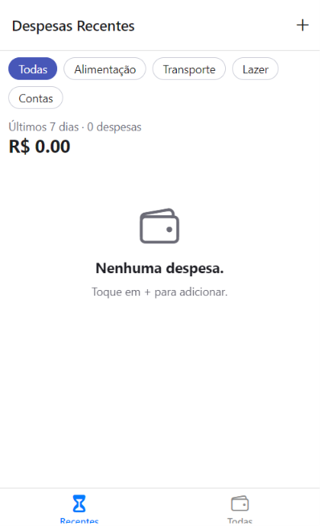
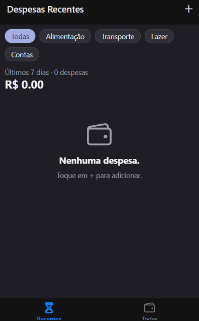
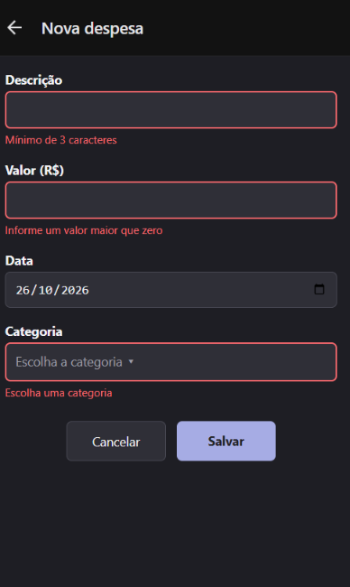

# Gerenciador de Despesas 2.0

Aplicativo de controle de despesas pessoais. Permite cadastrar, editar e excluir
despesas (com descrição, valor, categoria e data), consultar o total gasto, ver as
despesas dos últimos 7 dias, buscar por descrição e filtrar por categoria. Os dados
ficam salvos no aparelho mesmo após fechar o app, e as cores seguem o tema claro ou
escuro do sistema.

Projeto desenvolvido em React Native com Expo, como Atividade Prática da Aula 09
(Estado Global, Formulários e UX) da disciplina Programação para Dispositivos Móveis.

**Aluno:** _Kaio Alexandre de Morais_ — **Matrícula:** _25114290106_

## 1. Comando usado para criar o projeto

```bash
npx create-expo-app@latest Gerenciador-despesas-2.0 --template blank
```

## 2. Instalação de dependências

```bash
cd Gerenciador-despesas-2.0
npm install @react-navigation/native @react-navigation/bottom-tabs @react-navigation/native-stack
npx expo install react-native-screens react-native-safe-area-context
npx expo install @react-native-community/datetimepicker
npx expo install @react-native-async-storage/async-storage
```

O `@expo/vector-icons` (Ionicons) já vem incluído no projeto Expo. Para rodar no
navegador, também são necessários `react-dom`, `react-native-web` e
`@expo/metro-runtime` (`npx expo install react-dom react-native-web @expo/metro-runtime`).

Não foram usadas bibliotecas de estado ou de formulário (Redux, Zustand, Formik,
React Hook Form etc.): o estado global usa apenas Context API e `useReducer`, e a
validação é manual.

## 3. Como executar

```bash
npm install
npx expo start
```

Pressione `a` para abrir no emulador Android ou leia o QR code com o Expo Go. Se o
tema escuro não mudar, confira se o `app.json` tem `"userInterfaceStyle": "automatic"`
e reinicie com `npx expo start -c`.

> **Observação:** o seletor de data nativo (`@react-native-community/datetimepicker`)
> funciona em Android e iOS. No navegador (web), o app usa o seletor de data do
> próprio navegador, e a confirmação de exclusão usa `window.confirm`, pois o
> `Alert.alert` não exibe botões na web. Os testes completos devem ser feitos no
> emulador ou no celular.

## 4. Estrutura de arquivos

```
Gerenciador-despesas-2.0/
  App.js
  app.json
  package.json
  README.md
  src/
    components/
      IconButton.js
      despesa/
        DespesaItem.js
        DespesaLista.js
        DespesaSaida.js
        DespesaSumario.js
        FiltroCategorias.js
    constants/
      Categorias.js
      theme.js
    hooks/
      useDebounce.js
    screens/
      DespesasRecentes.js
      GerenciarDespesa.js
      TodasDespesas.js
    store/
      expenses-context.js
    utils/
      filtros.js
```

**Responsabilidade de cada arquivo:**

- `App.js` — navegação (Stack + Bottom Tabs), tema de navegação claro/escuro e
  `ExpensesContextProvider` envolvendo o `NavigationContainer`.
- `store/expenses-context.js` — `createContext`, `expensesReducer`,
  `ExpensesContextProvider`, hook `useExpenses()` e persistência com AsyncStorage.
- `screens/DespesasRecentes.js` — despesas dos últimos 7 dias, com filtro por categoria.
- `screens/TodasDespesas.js` — todas as despesas, com busca por descrição e filtro
  por categoria.
- `screens/GerenciarDespesa.js` — tela única para criar e editar despesa, com
  validação, Modal de categoria e exclusão com confirmação.
- `components/IconButton.js` — botão de ícone reutilizável (`Pressable` + `Ionicons`)
  usado no cabeçalho.
- `components/despesa/DespesaItem.js` — card da despesa (toque abre a edição).
- `components/despesa/DespesaLista.js` — `FlatList` com `ListEmptyComponent`.
- `components/despesa/DespesaSaida.js` — junta o sumário e a lista.
- `components/despesa/DespesaSumario.js` — quantidade e total das despesas exibidas.
- `components/despesa/FiltroCategorias.js` — chips de categoria.
- `constants/theme.js` — cores dos modos claro e escuro e a função `getColors`.
- `constants/Categorias.js` — lista `CATEGORIES`.
- `hooks/useDebounce.js` — hook personalizado para atrasar a busca.
- `utils/filtros.js` — função `filtrarPorCategoria`, que usa `.filter()`.

## 5. Modelo de dados

Cada despesa possui os campos:

```js
{
  id: '1712',            // texto, gerado pelo reducer
  description: 'Almoço', // texto
  amount: 18.5,          // número
  date: new Date(),      // Date
  category: 'Alimentação' // texto
}
```

## 6. Estado global e persistência

Tudo fica em `src/store/expenses-context.js`:

- **Reducer:** `expensesReducer` trata as ações `ADD`, `UPDATE`, `DELETE` e `SET`,
  sempre devolvendo um novo array (sem `push`, `splice` ou alteração direta).
- **Contexto:** o Provider expõe `expenses`, `addExpense`, `updateExpense` e
  `deleteExpense`. O hook `useExpenses()` lança um erro claro se usado fora do Provider.
- **Carga (ao abrir o app):** primeiro `useEffect`, com array de dependências vazio.
  Lê o AsyncStorage pela chave `@expenses`, faz `JSON.parse`, converte `date` de
  volta para `Date` e dispara `SET`. Erros são tratados com `try/catch`, e
  `isLoaded` vira `true` no `finally`.
- **Salvamento (a cada mudança):** segundo `useEffect`, com dependências
  `[expenses, isLoaded]`. Enquanto `isLoaded` é `false`, não grava, para não
  sobrescrever os dados salvos com a lista vazia inicial. Depois, grava com
  `JSON.stringify`, também com `try/catch`.

Nenhuma tela mantém lista própria: `DespesasRecentes` e `TodasDespesas` leem tudo
por `useExpenses()`.

## 7. Navegação

- **Native Stack:** rotas `Despesas` (com `headerShown: false`) e `GerenciarDespesa`.
- **Bottom Tabs** (dentro de `Despesas`): abas **Recentes** (ícone `hourglass`) e
  **Todas** (ícone `wallet-outline`).
- O botão **"+"** do cabeçalho é o `IconButton`, que recebe `icon`, `size`, `color`
  (via `tintColor`) e `onPress`, e navega para `GerenciarDespesa` sem parâmetros
  (modo criação).
- Ao tocar em um `DespesaItem`, o app navega para `GerenciarDespesa` com o parâmetro
  `expenseId` (modo edição).
- Em `GerenciarDespesa`, `route.params?.expenseId` define `isEditing`, e
  `navigation.setOptions` altera o título para "Nova despesa" ou "Editar despesa".

## 8. Formulário e validação

- **Estado único:** objeto `form` (`description`, `amount`, `date`, `category`) e
  função `handleChange(field, value)` com spread operator.
- **Máscara do valor:** regex `/^\d*\.?\d{0,2}$/` e `keyboardType="decimal-pad"`.
- **Data:** `DateTimePicker` em Android e iOS.
- **`validate(values)`** retorna um objeto `errors` com as regras:
  - descrição com no mínimo 3 caracteres;
  - valor maior que zero;
  - data não pode ser futura;
  - categoria obrigatória.
- Cada campo inválido mostra a mensagem abaixo e borda vermelha. A mensagem some
  quando o campo é corrigido.
- `addExpense` ou `updateExpense` só são chamados se não houver erros, com o valor
  convertido por `parseFloat`.
- **Categoria:** escolhida em um `Modal` (`transparent`, `animationType="slide"`)
  com a lista `CATEGORIES`, sem digitação livre.
- **Teclado:** o formulário está dentro de `KeyboardAvoidingView` (`padding` no iOS,
  `height` no Android) e `ScrollView`, para o teclado não cobrir o botão Salvar.
- **Exclusão:** botão visível só no modo edição. Em Android e iOS abre um
  `Alert.alert` com **Cancelar** (`style: 'cancel'`) e **Excluir**
  (`style: 'destructive'`). Após excluir ou salvar, volta com `navigation.goBack()`.

## 9. Listas, busca e tema

- **Lista vazia:** `ListEmptyComponent` com ícone, mensagem e orientação
  ("Nenhuma despesa. Toque em + para adicionar.").
- **Sumário:** `DespesaSumario` mostra a quantidade e o total das despesas exibidas,
  calculado com `.reduce()`. Quando o total passa de R$ 200,00, o valor fica em
  vermelho.
- **Busca:** `TextInput` em `TodasDespesas`, com `useDebounce` (400 ms, limpeza via
  `clearTimeout`) e a lista filtrada em `useMemo`, sem diferenciar maiúsculas de
  minúsculas. O total e a quantidade refletem a busca.
- **Filtro por categoria (bônus):** chips acima da lista, combináveis com a busca; o
  total reflete os dois filtros.
- **Tema:** `constants/theme.js` define as cores dos modos claro e escuro,
  aplicadas com `useColorScheme` em `TodasDespesas`, `DespesasRecentes`,
  `GerenciarDespesa`, na lista, nos cards, nos filtros e na navegação.
- **Sombra dos cards:** `Platform.select` (iOS: `shadow*`; Android: `elevation`).

## 10. Onde estão os principais conceitos

- **`.reduce()`:** `DespesaSumario.js`.
- **`.filter()`:** `utils/filtros.js`, `DespesasRecentes.js` e `TodasDespesas.js`.
- **`useReducer` e `useContext`:** `store/expenses-context.js`.
- **`useEffect`:** carga e salvamento em `expenses-context.js`; limpeza do timer em
  `useDebounce.js`.
- **`useMemo`:** lista filtrada em `TodasDespesas.js`.
- **`useState`:** formulário e Modal em `GerenciarDespesa.js`; busca e filtro nas
  telas de listagem.
- **`useNavigation`:** `DespesaItem.js`.
- **`useColorScheme`:** telas e componentes que usam `getColors`.

## 11. Roteiro de teste

1. Abrir o app sem dados: a lista mostra o estado vazio.
2. Tocar em "+" e salvar com tudo vazio: uma mensagem aparece em cada campo.
3. Descrição "ab", valor "0" e data de amanhã: as três mensagens aparecem.
4. Corrigir a descrição: só a mensagem dela desaparece.
5. Salvar uma despesa válida: ela aparece em **Todas** e, com data recente, em
   **Recentes**.
6. Tocar na despesa: abre "Editar despesa" preenchida; alterar o valor e salvar
   atualiza as duas abas, sem duplicar.
7. Excluir: **Cancelar** mantém a despesa; **Excluir** remove e volta para a lista.
8. Fechar o app por completo e reabrir: as despesas continuam.
9. Buscar "ALM" (maiúsculas) e depois um termo inexistente.
10. Alternar o tema do sistema entre claro e escuro.

## 12. Prints

**Lista de despesas (modo claro)**



**Lista de despesas (modo escuro)**



**Formulário com mensagens de erro**

