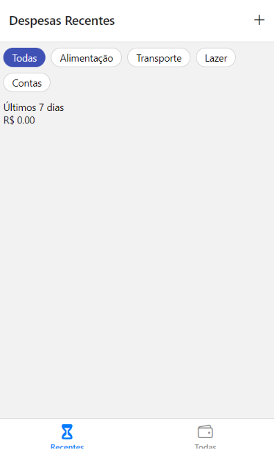
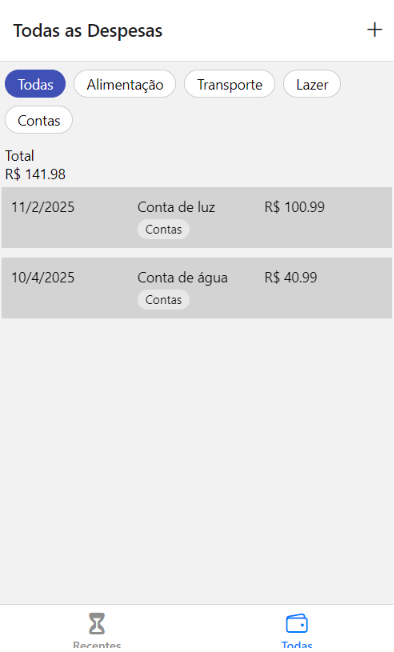
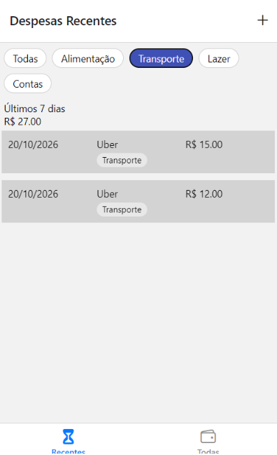
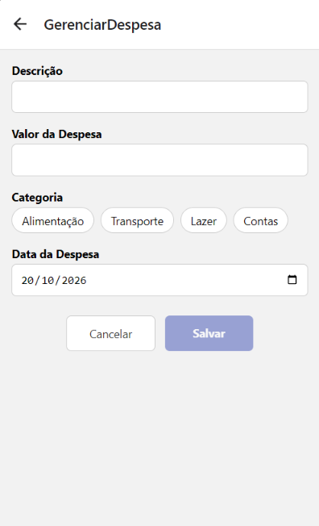
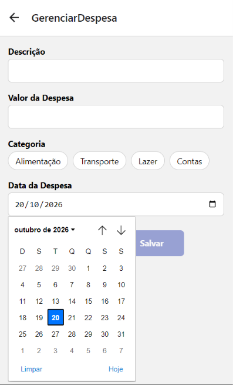
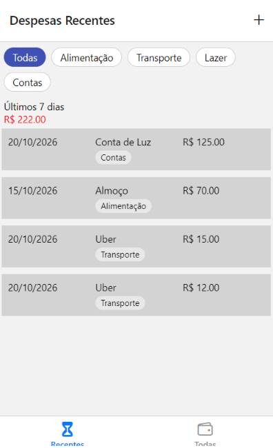

# Gerenciador de Despesas

Aplicativo simples de controle financeiro pessoal. Permite cadastrar despesas com
descrição, valor, categoria e data, visualizar o total gasto, consultar as despesas
dos últimos 7 dias e filtrar a lista por categoria.

Projeto desenvolvido em React Native com Expo, como atividade prática de Navegação
(Aulas 07 e 08) e Expansão do Gerenciador de Despesas da disciplina Programação
para Dispositivos Móveis.

## 1. Comando usado para criar o projeto

```bash
npx create-expo-app@latest GerenciadorDespesas --template blank
```

## 2. Instalação de dependências

```bash
cd GerenciadorDespesas
npm install @react-navigation/native @react-navigation/bottom-tabs @react-navigation/native-stack
npx expo install react-native-screens react-native-safe-area-context
npx expo install @react-native-community/datetimepicker
```

O pacote `@expo/vector-icons` (Ionicons) já vem incluído no projeto Expo.

## 3. Como executar

```bash
npx expo start
```

Em seguida, pressione `a` para abrir no emulador Android ou leia o QR code com o
aplicativo Expo Go.

> **Observação:** o `@react-native-community/datetimepicker` funciona em Android e
> iOS. No navegador (web) o modal de data não é exibido, portanto os testes do
> seletor de data devem ser feitos no emulador ou no celular.

## 4. Estrutura de arquivos

```
GerenciadorDespesas/
  App.js
  package.json
  app.json
  README.md
  src/
    constants/
      categorias.js
    context/
      DespesasContext.js
    utils/
      filtros.js
    screens/
      DespesasRecentes.js
      TodasDespesas.js
      GerenciarDespesa.js
    components/
      IconButton.js
      despesa/
        DespesaSaida.js
        DespesaSumario.js
        DespesaLista.js
        DespesaItem.js
        FiltroCategorias.js
```

**Responsabilidade de cada arquivo:**

- `App.js` — configura a navegação (Stack + Bottom Tabs) e envolve o app com o
  `DespesasProvider`.
- `constants/categorias.js` — lista de categorias (Alimentação, Transporte, Lazer,
  Contas), usada no formulário e no filtro.
- `context/DespesasContext.js` — estado global das despesas (`despesas` e
  `adicionarDespesa`), compartilhado entre as telas.
- `utils/filtros.js` — função `filtrarPorCategoria`, que usa `.filter()`.
- `screens/DespesasRecentes.js` — despesas dos últimos 7 dias, com filtro por
  categoria.
- `screens/TodasDespesas.js` — todas as despesas, com filtro por categoria.
- `screens/GerenciarDespesa.js` — formulário de cadastro de nova despesa.
- `components/IconButton.js` — botão de ícone reutilizável (`Pressable` +
  `Ionicons`), usado no cabeçalho.
- `components/despesa/DespesaSaida.js` — junta o sumário e a lista.
- `components/despesa/DespesaSumario.js` — soma das despesas com `.reduce()`.
- `components/despesa/DespesaLista.js` — `FlatList` com `keyExtractor`.
- `components/despesa/DespesaItem.js` — linha da lista (data, descrição, tag de
  categoria e valor).
- `components/despesa/FiltroCategorias.js` — botões de filtro por categoria.

## 5. Navegação

A navegação está configurada em `App.js` com dois níveis:

- **Native Stack** (`createNativeStackNavigator`): contém a rota `Despesas` (com
  `headerShown: false`) e a rota `GerenciarDespesa`.
- **Bottom Tabs** (`createBottomTabNavigator`), aninhado dentro da rota `Despesas`:
  abas **Recentes** (ícone `hourglass`) e **Todas** (ícone `wallet-outline`), ambas
  com `tabBarLabelStyle: { fontSize: 12 }`.

O botão **"+"** no cabeçalho das abas é o componente `IconButton`, recebendo `icon`,
`size`, `color` (via `tintColor`) e `onPress`. Ao ser pressionado, executa
`navigation.navigate('GerenciarDespesa')`.

## 6. Funcionalidades principais

- Cadastro de despesa com **descrição**, **valor**, **categoria** e **data**.
- Campo de valor com `keyboardType="decimal-pad"` e validação por regex
  (`/^\d*\.?\d{0,2}$/`), limitando a duas casas decimais.
- Seleção de data com o `@react-native-community/datetimepicker`.
- Seleção de categoria com componentes `Pressable` dispostos lado a lado.
- Validação do formulário: o botão **Salvar** só é habilitado quando descrição,
  valor e categoria estão preenchidos.
- Estado global com Context API: a despesa criada aparece automaticamente nas telas
  **Recentes** e **Todas**.
- Total das despesas exibidas calculado com `.reduce()` e formatado com
  `.toFixed(2)`.
- **Filtro por categoria** com `.filter()`: a lista e o total são recalculados
  apenas para a categoria selecionada.
- Tela **Recentes** exibe somente as despesas dos últimos 7 dias.
- Cada despesa exibe uma **tag** com a categoria, com fundo cinza claro e bordas
  arredondadas.
- **Desafio extra:** quando o total das despesas exibidas ultrapassa R$ 200,00, o
  valor do sumário fica em **vermelho**.
- Lista renderizada com `FlatList` e `keyExtractor`.

## 7. Onde estão os principais conceitos

- **`.reduce()`:** `DespesaSumario.js`, constante `somaDespesas`.
- **`.filter()`:** `utils/filtros.js` (categoria) e `screens/DespesasRecentes.js`
  (últimos 7 dias).
- **`useState`:** `GerenciarDespesa.js` (descrição, valor, categoria, data e
  exibição do picker), `DespesasContext.js` (lista de despesas) e as telas de
  listagem (categoria selecionada no filtro).
- **`useContext`:** telas `DespesasRecentes`, `TodasDespesas` e `GerenciarDespesa`.
- **`useNavigation`:** `GerenciarDespesa.js`, para voltar à tela anterior.
- **Props e desestruturação:** `IconButton({ icon, size, color, onPress })`,
  `DespesaSaida({ despesas, periodo })`, entre outros.

## 8. Limitações conhecidas

- As despesas ficam armazenadas apenas em memória: ao fechar o aplicativo, os
  dados cadastrados são perdidos e voltam a ser os dados de exemplo.
- A edição e a exclusão de despesas não fazem parte do escopo desta atividade.

## 9. Prints

**Despesas Recentes**



**Todas as Despesas**



**Filtro por categoria**



**Gerenciar Despesa (formulário)**



**Seletor de data**



**Total acima de R$ 200,00 (valor em vermelho)**

